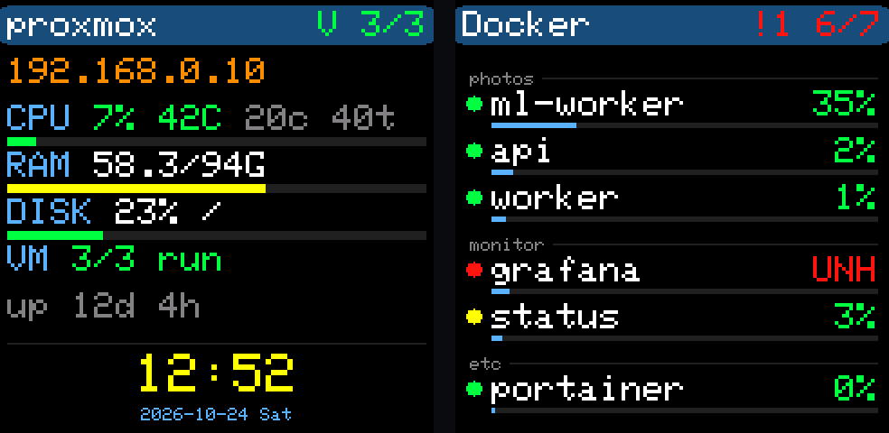

# PC 창 (화면 보드 없이)

화면 보드 없이 **PC 화면에 240×240 창**을 띄워 SmallTV·ESP32-S3 화면과 똑같이 보여 줍니다. 그리는 좌표·색·글꼴(6×8 픽셀 글꼴)이 펌웨어와 같아서 1.54" 화면 그대로입니다. 화면 보드를 사기 전에 시험하거나, 모니터 구석에 띄워 두는 용도로 씁니다.

**하드웨어 없이 서버 송출 확인**: 서버 프로그램을 설치한 뒤 이 창을 띄워, 그 서버의 정보·목록이 제대로 나오는지 보면 송출·방화벽·네트워크가 맞는지 바로 알 수 있습니다([server.md](server.md#화면-보드-없이-송출-확인하기)).



## 준비물

- 파이썬 3.7 이상(표준 라이브러리만 씀, 따로 설치할 패키지 없음). Windows는 [python.org](https://www.python.org/downloads/) 설치판(tkinter 포함)
- [`desktop/hostinfo_window.py`](../desktop/hostinfo_window.py) 파일 하나
- 같은 LAN에 [서버 프로그램](server.md)(`--broadcast`)이 도는 컴퓨터

## 실행

```sh
python hostinfo_window.py              # 240x240(화면 보드와 같은 크기)
python hostinfo_window.py --scale 2    # 2배(480x480)
```

Windows는 `pythonw hostinfo_window.py`로 띄우면 검은 콘솔 창 없이 뜹니다. 처음 실행할 때 Windows 방화벽이 묻는 창이 뜨면 **허용**을 누릅니다(UDP 4210 받기).

**로그인할 때 저절로 띄우기(Windows)** — PowerShell에서 한 번:

```powershell
$py = (Get-Command pythonw).Source
$s = (New-Object -ComObject WScript.Shell).CreateShortcut("$([Environment]::GetFolderPath('Startup'))\hostinfo.lnk")
$s.TargetPath = $py; $s.Arguments = '"' + (Resolve-Path .\hostinfo_window.py) + '"'; $s.Save()
```

## 다루기

- **왼쪽 클릭**: 다음 화면
- **오른쪽 클릭** 메뉴:
  - 항상 위
  - 테두리 없이: 끌어서 옮깁니다
  - 크기: 1~4배
  - 서버 주소, 날씨 위치, 보일 서버
  - 종료
- 창 위치와 설정은 `%APPDATA%\hostinfo-window.json`(맥·리눅스는 `~/.config/hostinfo-window.json`)에 남습니다.

## 동작

화면 보드와 같습니다.

- UDP 4210으로 서버 상태를 받습니다.
- 5초마다 UDP 4211로 "여기 있음"을 보냅니다. 받는 곳은 설정한 서버 주소, 브로드캐스트, 이 PC입니다.
- 화면은 서버 정보 8초 → 목록 쪽마다 6초 → 날씨·시계 5초 순서로 돕니다.
- 같은 PC에서 서버 프로그램을 돌리면 이 PC 정보도 함께 나옵니다.

다른 점은 두 가지입니다.

- 시계는 이 PC의 시각과 시간대를 씁니다.
- 날씨는 HTTPS로 받습니다.

## 문제가 생기면

| 증상 | 할 일 |
|---|---|
| 화면에 `UDP 4210 busy` | 이 PC에서 같은 창이 이미 떠 있습니다. 하나만 띄웁니다. |
| 날짜·시계·날씨만 나옵니다 | 서버가 `--broadcast`로 도는지, 이 PC 방화벽에서 python(pythonw)의 UDP 4210 받기가 허용됐는지 봅니다. 그래도 안 되면 메뉴 '서버 주소'에 서버 IP를 적습니다. |
| `No module named tkinter` | 리눅스는 `sudo apt install python3-tk`. Windows·맥은 python.org 설치판을 씁니다. |
