# SmallTV 설치 방법

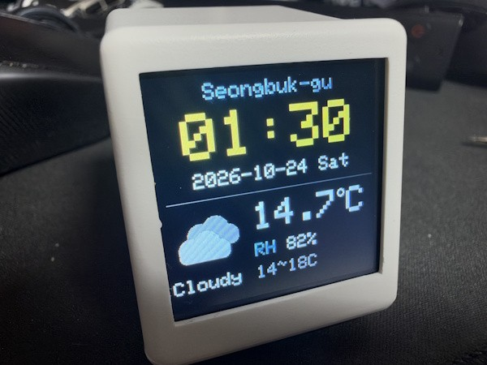

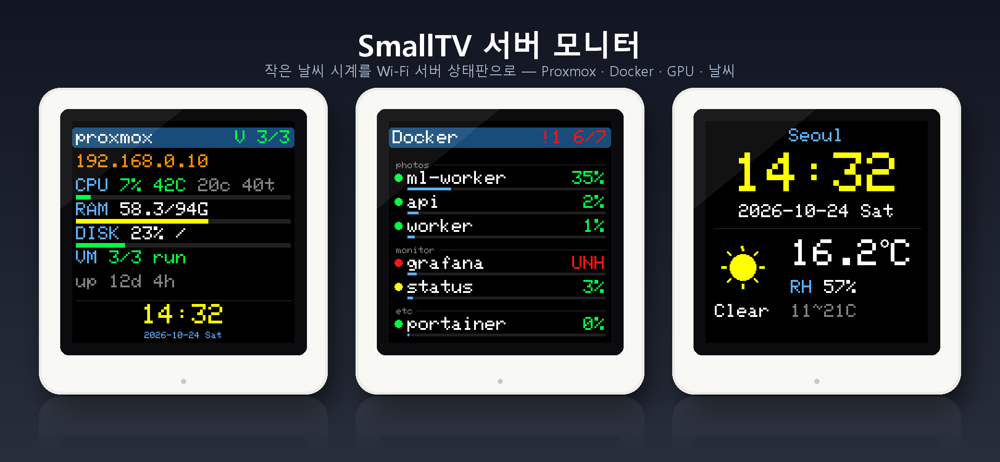

GeekMagic **SmallTV**(Smart Weather Clock)는 ESP8266과 1.54" 화면이 들어간 작은 날씨 시계입니다. 원래 펌웨어를 이 프로젝트의 펌웨어로 바꾸면 **집이나 사무실 서버들의 상태를 번갈아 보여 주는 모니터**가 됩니다. 납땜도, USB 케이블 연결도 필요 없고 Wi-Fi로만 설치합니다.

화면에는 이렇게 나옵니다.

- **서버 정보**(서버마다 8초): 이름 · IP · CPU 사용률·온도 · RAM · 디스크 · VM 수 · GPU · 켜진 시간
- **목록**(리눅스 서버만, 쪽마다 6초): Docker 컨테이너와 Proxmox VM의 상태·CPU·메모리. 문제 있는 컨테이너(unhealthy·재시작 반복·비정상 종료)는 빨간색으로 맨 위에 나옵니다.
- **날씨·시계**(한 바퀴마다 5초): 기온 · 습도 · 날씨 아이콘 · 오늘 최저/최고 · 날짜 · 큰 시계

보낼 서버가 없거나 끊기면 날짜·시계·날씨만 나옵니다. 그래서 서버가 꺼져 있어도 탁상시계로 쓸 수 있습니다.

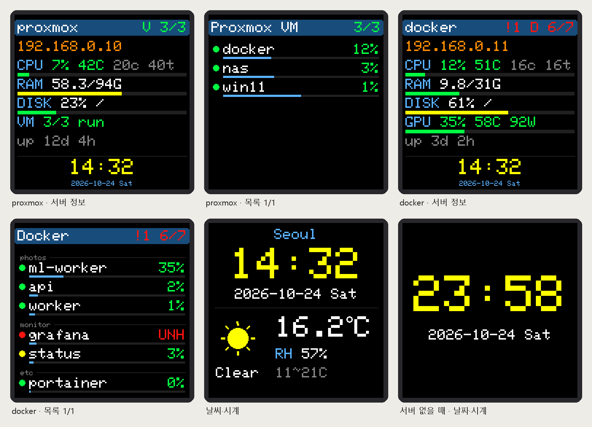

*화면 그림은 펌웨어의 그리기를 그대로 흉내 내 만든 것입니다(값은 예시).*

## 필요한 파일

이 저장소에서 내려받습니다(초록 **Code** 버튼 → **Download ZIP**, 또는 파일마다 열어 **Download raw file**).

| 파일 | 쓰는 곳 |
|---|---|
| [`bin/SDP-hostinfo-smalltv.bin`](../bin/SDP-hostinfo-smalltv.bin) | SmallTV에 올릴 펌웨어 |
| [`server/`](../server/) | 서버에서 상태를 보내는 프로그램과 설치 스크립트([server.md](server.md)) |

## 준비물

- **GeekMagic SmallTV**: ESP8266(ESP-12F) 판, 1.54" 240×240 화면. 원래 펌웨어 웹 화면 제목이 "Smart Weather Clock"이고 아래쪽에 **Firmware Update (OTA)** 메뉴가 있는 것입니다.
  - 이 문서는 원래 펌웨어 SD Pro V1.0.6이 든 기기로 시험했습니다. 기판이 ESP32인 판(Pro 등)에는 맞지 않습니다.
  - 7~8천 원쯤 합니다. 장바구니에 넣어 두고 알뜰장터에서 보면 5천 원 전후로 올라오는 것도 있습니다. 옵션은 **ULTRA**를 고릅니다.

    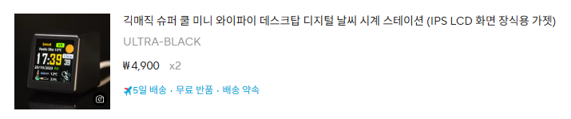

    구매 링크: <https://ko.aliexpress.com/item/1005011924447121.html>
- USB-C 전원(휴대폰 충전기). SmallTV의 USB-C는 전원 전용입니다.
- **2.4GHz Wi-Fi**(ESP8266은 5GHz를 쓰지 못합니다).
- 상태를 보여 줄 서버: 리눅스·Windows·맥 어느 것이든 됩니다. **파이썬 3**이 있어야 합니다.
- 휴대폰(SmallTV 설정 화면에 붙을 때 씁니다).

## 어떻게 동작하나

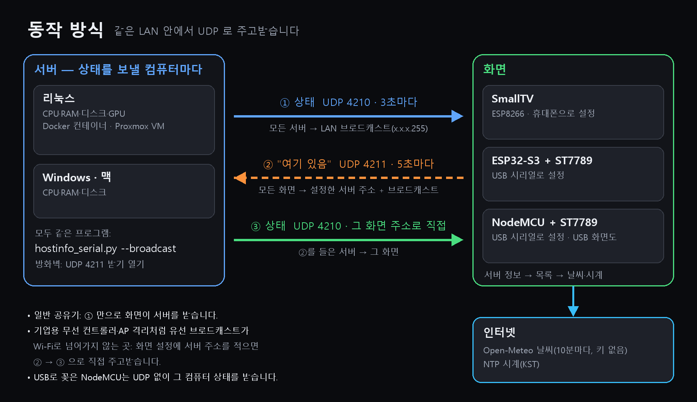

- 서버는 같은 LAN에 상태를 뿌립니다(브로드캐스트).
- 일반 공유기라면 SmallTV가 그대로 받으므로 따로 설정할 것이 없습니다.
- 일부 환경에서는 유선의 브로드캐스트가 Wi-Fi로 넘어가지 않습니다. 기업용 무선 컨트롤러, 일부 메시 Wi-Fi, AP 격리 기능 등이 그렇습니다. 이때는 SmallTV 설정에 **서버 주소**를 적어 두면 됩니다(4번). SmallTV가 그 주소로 "여기 있음"을 보내면, 서버가 SmallTV에 직접 보냅니다.

---

## 1. 서버에 보내는 프로그램 설치

화면에 나올 컴퓨터마다 설치합니다. 리눅스·Windows·맥 설치 방법은 **[server.md](server.md)**에 있습니다. 핵심만 적으면 이렇습니다.

- 리눅스: `/etc/default/hostinfo-serial`에 `HOSTINFO_ARGS=--broadcast`를 넣고 `sudo sh install-linux.sh`
- Windows: `install-windows.ps1` 실행 후 방화벽 UDP 4211 열기
- 맥: `sh install-mac.sh`

---

## 2. 원래 펌웨어 확인하고 Wi-Fi에 붙이기

SmallTV는 같은 겉모양이라도 **원래 펌웨어가 두 가지**입니다. 처음 켰을 때 화면과 Wi-Fi 이름으로 구분합니다. 안의 기판(ESP-12F)·화면·핀은 같아서 올릴 파일은 똑같고, 업데이트 메뉴만 다릅니다.

| | **A. Smart Weather Clock (SD Pro)** | **B. SmallTV-Ultra** |
|---|---|---|
| 처음 켰을 때 Wi-Fi 이름 | `Smart Weather Clock` | `GIFTV` |
| 처음 화면 | 연결 안내 → `SD Pro V1.0.x` | `Manual Online` QR, `WiFi: GIFTV`, `http://192.168.4.1` |
| 설정 화면 | WiFi Settings · City Settings · Photo · GIF | 위쪽 메뉴 Network · Weather · Time · Pictures · Settings |
| 펌웨어 올리는 곳 | **Firmware Update (OTA)** = `/update_ota`(파일 이름이 `SDP`로 시작해야 함) | **Settings → 7. Firmware update** = `/update` |


### A. Smart Weather Clock (SD Pro)

1. 전원을 넣고, 휴대폰 Wi-Fi 목록에서 **`Smart Weather Clock`**에 붙습니다. '인터넷 없음' 경고가 나와도 그대로 붙어 있습니다.

   

2. 설정 화면이 저절로 뜨지 않으면 휴대폰 데이터를 잠깐 끄고 브라우저로 `http://192.168.4.1`을 엽니다.
3. **WIFI SETTINGS**의 목록에서 집 Wi-Fi를 고르고(없으면 Refresh List) 비밀번호를 넣고 **Connect**. SmallTV가 다시 켜집니다.

   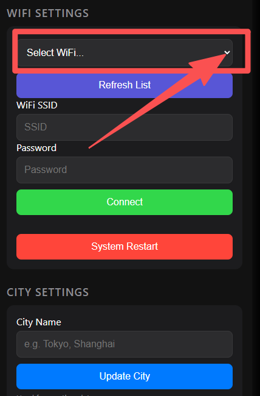

4. 켜질 때 화면에 노란 글씨로 **IP 주소**(예: `192.168.0.125`)가 나옵니다. 적어 둡니다. PC 브라우저로 `http://<그 주소>`를 열면 설정 페이지가 나옵니다.

   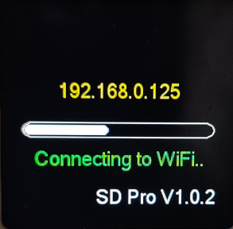

(Wi-Fi 설정·IP 화면 그림은 제품 설명서 *Smart Clock Manual V1.2.1*에서, Wi-Fi 목록 그림은 휴대폰 화면에 이름만 바꿔 넣은 예시입니다.)

### B. SmallTV-Ultra

제조사 안내(상자 QR 페이지): [GeekMagic SmallTV-Ultra 안내](https://qr61.cn/onQs0U/qlPEzlA) — 한국어 사용자 설명서([V9.0.30 PDF, AI 번역](https://ncstatic.clewm.net/rsrc/2025/0430/12/57ce98fdda436e684ed70e7d067fee37.pdf)), 영어 설명서([V9.0.30 PDF](https://ncstatic.clewm.net/rsrc/2025/0430/12/042f99ffc128618bcc9e38767c132966.pdf)), 원래 펌웨어([smalltv-ultra, 권장 V9.0.50](https://github.com/GeekMagicClock/smalltv-ultra/tree/main/Ultra-V9.0.50)). 원래 펌웨어의 날씨·시계 설정은 이 설명서를 보면 됩니다.

1. 전원을 넣으면 화면에 `WiFi: GIFTV`, `http://192.168.4.1`이 나옵니다.

   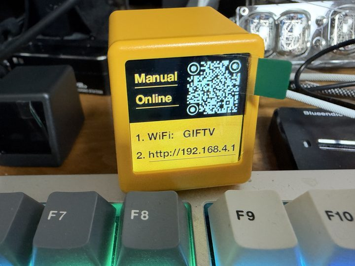

2. 휴대폰을 **`GIFTV`**(보안 없는 네트워크)에 붙입니다. 설정 화면이 저절로 뜨지 않으면 `http://192.168.4.1`을 엽니다.

   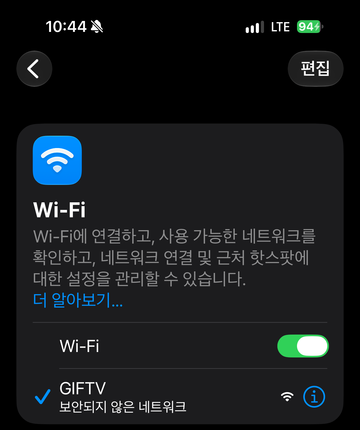

3. **Network** → Wi-Fi 이름·비밀번호 → **SAVE**. 붙으면 날씨 시계가 나오고, 켜질 때 새 IP 주소를 보여 줍니다. 적어 둡니다. (Ultra는 휴대폰을 `GIFTV`에 붙인 채 3절을 바로 해도 됩니다.)

    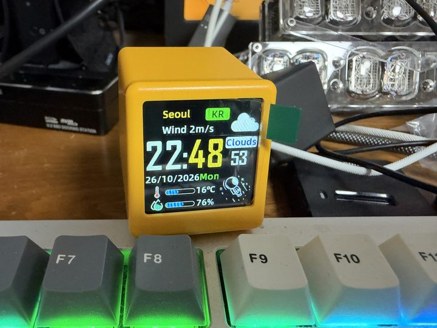

## 3. 펌웨어 바꾸기

### A. Smart Weather Clock (SD Pro)

1. 설정 페이지 아래쪽 **Firmware Update (OTA)**에서 파일 선택 → `SDP-hostinfo-smalltv.bin`을 고릅니다.
   - 원래 펌웨어는 이름이 `SDP`로 시작하는 파일만 받습니다. 이 파일은 이미 그렇게 지어 두었으니 이름을 바꾸지 않습니다.
2. **Start Update**를 누르고, 확인 창에서 확인을 누릅니다.
3. "Update Success! Rebooting..."이 나오면 끝입니다. SmallTV가 다시 켜집니다.

명령으로 해도 됩니다(Windows 10 이상·맥·리눅스에 기본으로 있는 `curl`).

```sh
curl -F "update=@SDP-hostinfo-smalltv.bin" http://<SmallTV 주소>/update_ota
```

`OK`가 나오면 성공입니다.

### B. SmallTV-Ultra

1. 설정 화면 **Settings** 맨 아래 **7. Firmware update → UPLOAD**(= `http://<주소>/update`)에서 `SDP-hostinfo-smalltv.bin`을 고르고 **Update**. "Update Success! Rebooting..."이 나오면 끝입니다. 아래쪽 `Model: SmallTV-Ultra, Version: Ultra-V9.0.51`로 Ultra인 것을 한 번 더 확인할 수 있습니다(2026-10-26 이 판에서 확인).

   

   명령으로 할 때(집 Wi-Fi에 붙어 있으면):

   ```sh
   curl -F "firmware=@SDP-hostinfo-smalltv.bin" http://<SmallTV 주소>/update
   ```

2. 다시 켜지면 이 펌웨어의 설정 화면이 나옵니다(`Wi-Fi setup`, `join hostinfo-xxxxxx`, `open 192.168.4.1`). **원래 펌웨어에 넣은 Wi-Fi는 쓰지 않으니** 아래 4절대로 다시 넣습니다.

   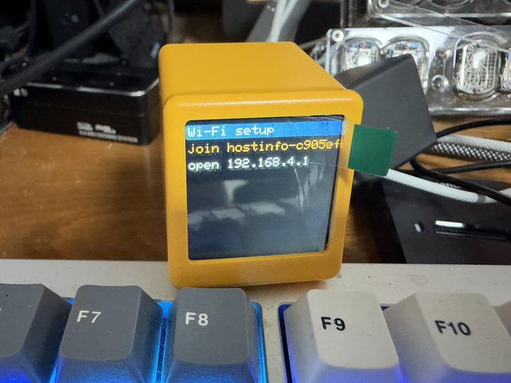 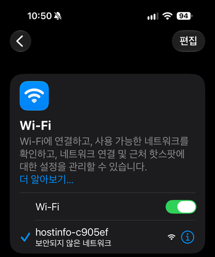 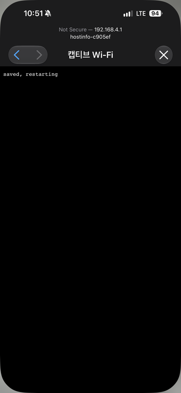

원래 Ultra 펌웨어로 되돌리려면 GeekMagic GitHub([smalltv-ultra](https://github.com/GeekMagicClock/smalltv-ultra), 제조사 권장 [V9.0.50](https://github.com/GeekMagicClock/smalltv-ultra/tree/main/Ultra-V9.0.50))의 펌웨어를 아래 'OTA' 방법으로 올립니다.

## 4. SmallTV 설정 (휴대폰)

다시 켜지면 화면에 이렇게 나옵니다.

```
Wi-Fi setup
join hostinfo-xxxxxx
open 192.168.4.1
```

1. 휴대폰 Wi-Fi 목록에서 **`hostinfo-xxxxxx`**에 연결합니다(비밀번호 없음).
2. 브라우저에서 **`http://192.168.4.1`**을 엽니다. 휴대폰이 설정 페이지를 저절로 띄우기도 합니다.
   - "인터넷 없음" 경고가 뜨면 **연결 유지**를 고릅니다.
   - 페이지가 안 열리면 모바일 데이터를 잠깐 끕니다.
3. 칸을 채웁니다.

   | 칸 | 넣을 값 |
   |---|---|
   | SSID | Wi-Fi 이름. 여러 곳에서 쓰려면 쉼표로 여러 개를 적습니다(예: `home,office`). 그중 신호가 센 곳에 붙습니다 |
   | Wi-Fi 비밀번호 | Wi-Fi 비밀번호. SSID가 여러 개면 모두 같은 비밀번호여야 합니다 |
   | OTA 비밀번호 | 나중에 설정을 바꾸거나 펌웨어를 업데이트할 때 쓸 비밀번호입니다. 직접 정하되 **꼭 적어 둡니다**. 잊으면 케이스를 열어야 합니다. 휴대폰으로 넣기 번거로우면 지금은 비워 두고 Wi-Fi에 붙은 뒤 PC에서 넣어도 됩니다(아래 'OTA 비밀번호를 PC에서 넣기') |
   | 날씨 위치 | 비우면 서버가 알려 준 위치(`--geo`)를, 그것도 없으면 IP로 찾은 위치를 씁니다. 직접 정하려면 `위도,경도,이름`(예: `37.566,126.978,Seoul`)을 적습니다. `off`면 날씨를 끕니다 |
   | 보일 서버 | `all`이면 모든 서버를 번갈아 보입니다. 한 대만 보이려면 그 서버의 호스트 이름을 적습니다 |
   | 알림 보낼 서버 주소 | 보통은 비워 둡니다. 서버가 안 보이면 서버 IP를 쉼표로 적습니다(예: `192.168.0.10,192.168.0.11`). '어떻게 동작하나'를 참고하세요 |

4. **저장하고 다시 켜기**를 누릅니다.

다시 켜져 Wi-Fi에 붙으면 화면에 **새 IP 주소를 15초 동안 크게** 보입니다(`http://<주소>`, `hostinfo-xxxxxx.local`). 그 뒤 서버 정보와 날씨가 나오기 시작합니다.

### SmallTV 주소 찾기

설정을 바꾸거나 펌웨어를 올릴 때 SmallTV의 IP 주소가 필요합니다. 아래 중 편한 방법을 씁니다.

1. **화면**: Wi-Fi에 붙을 때마다 주소를 15초 동안 보입니다. 지난 주소를 모르겠으면 전원을 뽑았다 꽂으면 됩니다.
2. **이름으로**: 브라우저에 `http://hostinfo-xxxxxx.local`(`xxxxxx`는 화면·Wi-Fi 설정 때 본 6자리)을 넣습니다. 맥·아이폰·안드로이드 대부분·Windows 10 이상에서 됩니다. 기업용 무선(무선 컨트롤러 등)이나 일부 공유기는 이 이름 찾기(mDNS)를 막아 안 될 수 있습니다.
3. **공유기 접속 기기 목록**: 이름 `hostinfo-xxxxxx`로 나옵니다(원래 펌웨어일 때는 `ESP-xxxxxx`).

### OTA 비밀번호를 PC에서 넣기

OTA 비밀번호가 길어 휴대폰으로 넣기 번거로우면, 4번에서 비워 두고 SmallTV가 Wi-Fi에 붙은 뒤 PC에서 넣습니다. 비밀번호를 복사해 붙여 넣을 수 있어 편합니다.

1. PC 브라우저로 `http://<SmallTV 새 주소>`를 엽니다. 주소는 위 'SmallTV 주소 찾기'를 봅니다.
2. **OTA 비밀번호** 칸에만 비밀번호를 넣습니다. 다른 칸은 지금 값이 채워져 있으니 그대로 둡니다. Wi-Fi 비밀번호 칸은 비워 두면 예전 값을 그대로 씁니다.
3. **저장하고 다시 켜기**를 누릅니다. 몇 초 뒤 다시 붙습니다.

OTA 비밀번호가 아직 없을 때만 이렇게 비밀번호 확인 없이 저장됩니다. 한 번 넣은 뒤로는 설정을 바꿀 때마다 맨 아래 **지금 OTA 비밀번호**를 넣어야 합니다.

비워 둔 채로 두면 같은 LAN의 누구나 이 설정 페이지에서 Wi-Fi·OTA 설정을 바꿀 수 있습니다. 그러니 설치를 마치면 바로 넣어 두세요.

**권장**: 공유기 설정에서 SmallTV와 서버들에 **DHCP 고정 할당**(주소 예약)을 해 둡니다. 주소가 바뀌면 '알림 보낼 서버 주소'에 적은 값이 맞지 않게 됩니다. 메뉴 이름은 공유기마다 다릅니다(고정 IP, 주소 예약, Static Lease 등).

## 5. 확인

- PC 브라우저로 `http://<SmallTV 새 주소>`를 열면 같은 설정 페이지가 나옵니다.
  - 첫 줄에 `Wi-Fi <SSID> <주소>`와 날씨가 표시돼야 합니다.
  - 여기서 설정을 바꿀 때는 맨 아래 **지금 OTA 비밀번호**를 넣어야 저장됩니다. 비워 둔 비밀번호 칸은 예전 값 그대로 둡니다.
- 서버 쪽 기록에 `display <SmallTV 주소> hostinfo-xxxxxx`가 보이면 서로 찾은 것입니다.

## 화면 읽는 법

- **제목줄**: 서버 이름입니다. 오른쪽은 목록 요약입니다(`D 11/11` = Docker 11개 중 11개 정상, 빨간 `!1` = 문제 1개).
- **줄 색**: 초록은 정상, 노랑은 시작 중, 빨강은 문제, 회색은 꺼짐입니다.
- **시계**: 한국 시간(KST) 고정입니다. 시간은 인터넷 NTP로 맞춥니다.
- **날씨**: [Open-Meteo](https://open-meteo.com/)에서 10분마다 받습니다. API 키는 필요 없습니다.

---

## 나중에 펌웨어 업데이트하기 (Wi-Fi)

새 펌웨어가 나오면 PC에서 Wi-Fi로 올립니다. 필요한 것은 `espota.py` 하나입니다(ESP8266 Arduino 코어에 들어 있는 OTA 도구).

1. [espota.py](https://raw.githubusercontent.com/esp8266/Arduino/master/tools/espota.py)를 받습니다. 파이썬 3만 있으면 됩니다.
2. 실행합니다.

   ```sh
   python espota.py -i <SmallTV 주소> -p 8266 -a "<OTA 비밀번호>" -f SDP-hostinfo-smalltv.bin
   ```

3. `Authenticating...OK` 뒤 진행 표시가 끝나면 SmallTV가 다시 켜집니다. 화면에도 진행 막대가 나옵니다.
   - 설정(Wi-Fi·비밀번호 등)은 그대로 남습니다.
   - `Authenticating...FAIL`이 나오면 OTA 비밀번호가 틀린 것입니다. SmallTV에는 아무 일도 생기지 않습니다.

## 문제가 생기면

| 증상 | 할 일 |
|---|---|
| 펌웨어를 바꾼 뒤 화면이 까맣습니다 | 휴대폰 Wi-Fi 목록에 `hostinfo-xxxxxx`가 보이면 펌웨어는 돌고 있습니다. 4번을 계속합니다. |
| `192.168.4.1`이 안 열립니다 | 주소창에 `http://`까지 직접 입력합니다. 모바일 데이터를 끄고, "인터넷 없음" 경고에서 연결 유지를 고릅니다. |
| Wi-Fi에 못 붙습니다 | 2.4GHz인지, SSID·비밀번호가 맞는지 봅니다. 3분 동안 못 붙으면 `hostinfo-xxxxxx` 설정 Wi-Fi가 다시 열립니다(집 Wi-Fi는 계속 시도합니다). 전원을 껐다 켜도 됩니다. |
| 날짜·시계·날씨만 나오고 서버가 안 나옵니다 | ① 서버 프로그램이 `--broadcast`로 돌고 있는지(server.md의 확인 방법) ② 서버 방화벽의 UDP 4211을 봅니다. ③ 그래도 안 되면 SmallTV '알림 보낼 서버 주소'에 서버 IP를 적습니다. |
| 날씨 위치가 다른 동네입니다 | IP로 찾은 위치입니다. 서버에 `--geo`를 주거나 SmallTV '날씨 위치'에 좌표를 넣습니다. |
| 시계가 9시간 틀립니다 | 서버 시간대 문제입니다. 리눅스는 `TZ=Asia/Seoul`을 넣습니다(server.md의 리눅스). |
| 저장할 때 `wrong OTA password`가 나옵니다 | '지금 OTA 비밀번호'가 틀렸습니다. 다시 넣습니다. |
| OTA 비밀번호를 잊었습니다 | Wi-Fi로는 풀 수 없습니다. 아래 '케이스를 열고 시리얼로 연결하기'를 봅니다. |

## 케이스를 열고 시리얼로 연결하기 (비상용)

OTA 비밀번호를 잊었거나 펌웨어가 망가졌을 때만 씁니다. 필요한 것은 다음과 같습니다.

- 3.3V USB-TTL 어댑터(CH340·CP2102 등). **5V로 연결하면 ESP8266이 망가집니다.**
- 점퍼선

케이스를 열면 기판 가운데에 ESP-12F 모듈이 있습니다. 모듈 가장자리의 패드에 연결합니다.

| ESP-12F 패드 | USB-TTL |
|---|---|
| TX(GPIO1) | RX |
| RX(GPIO3) | TX |
| GND | GND |
| GPIO0 | 굽기 때만 GND에 |

전원은 SmallTV의 USB-C로 넣습니다. 어댑터의 3.3V·5V 핀은 연결하지 않습니다. 패드 위치는 ESP-12F 표준 배치를 따르지만, 납땜 전에 모듈 뒷면 표시나 테스터로 확인합니다.

- **설정만 바꾸기**: 시리얼 터미널(115200bps, 줄 끝 LF)에서 아래 명령을 보냅니다. GPIO0은 연결하지 않습니다.

  ```
  CFG ssid <Wi-Fi 이름>
  CFG pass <Wi-Fi 비밀번호>
  CFG ota <새 OTA 비밀번호>
  CFG RESTART
  ```

- **펌웨어 다시 굽기**:
  1. GPIO0을 GND에 붙인 채 전원을 넣어 굽기 모드로 만듭니다.
  2. 굽습니다. `esptool`은 `pip install esptool`로 설치합니다.

     ```sh
     python -m esptool --port <COM 포트 또는 /dev/ttyUSB0> -b 460800 write_flash 0x0 SDP-hostinfo-smalltv.bin
     ```

  3. 끝나면 GPIO0을 떼고 전원을 다시 넣습니다.

## 원래 펌웨어로 되돌리기

원래 펌웨어(SD Pro)는 제조사 쪽 GitHub [JUZIPi-tech/SD_PRO](https://github.com/JUZIPi-tech/SD_PRO)에 있습니다(`SDPro_V1.0.6_….bin`).

- **Wi-Fi로**: 위 espota 명령에서 `-f`에 SD Pro 파일을 줍니다.
- **시리얼로**: 위 esptool 명령에서 파일만 바꿉니다.

## 참고

- 화면 연결(실물로 확인): SCK GPIO14, MOSI GPIO13, DC GPIO0, RST GPIO2, CS 없음(SPI 모드 3), 백라이트 GPIO5(LOW일 때 켜짐). 화면이 케이스에 위아래가 뒤집혀 붙어 있어 펌웨어가 180° 돌려 그립니다.
- 펌웨어는 Arduino(ESP8266)와 Adafruit ST7789·GFX 라이브러리로 만들었습니다.
- 펌웨어를 바꾸면 제조사 보증을 받지 못할 수 있습니다. 각자 판단해서 진행하세요.
